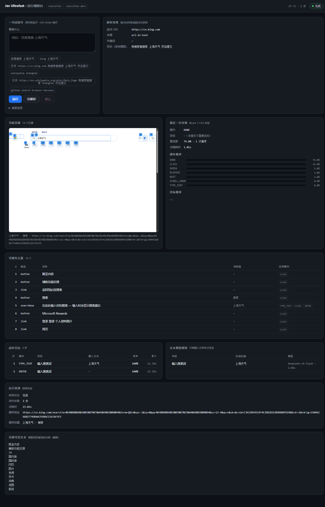

# Jev Ultrafast ⚡

> [!IMPORTANT]
> **The Browser Use Cloud waitlist is open.** Get early access to ultrafast browser agents in the cloud.
> **[Join the waitlist →](https://browser-use.com/ultrafast?utm_source=github&utm_medium=readme&utm_campaign=jev-ultrafast)**

**A browser agent with a dynamic, indexed action space.**

Give it one goal. [TypeSafe's Jev](https://docs.typesafe.ai/introduction) picks an operation and an element. A small LLM writes text only when the operation is `TYPE_TEXT`.

**Zürich → London on Google Flights in 7.1 seconds.** One natural-language goal, actual text generation, and loading waits included.

<a href="docs/demo.mp4"></a>

[Watch the MP4](docs/demo.mp4) · [Measurements](docs/performance.md) · [Read the loop](jev_ultrafast/agent.py)

**中文说明：[README.md](README.md)** — 这个分支的中文优先首页，装环境、配端点、跑第一句话、排错都在里面。


## The action space

Every observation produces a new element table:

```text
[1] button    Change ticket type · Round trip
[2] combobox  Where from?        · San Francisco
[3] combobox  Where to?          · empty
[4] textbox   Departure          · empty
...
```

The operations are `CLICK`, `TYPE_TEXT`, `ENTER`, `SELECT`, `SCROLL_UP`, `SCROLL_DOWN`, `WAIT`, `DONE`, and `BLOCKED`. Only supported operations and targets are offered.

`ENTER` exists because a lot of forms have no visible submit control: Bing's search button is a `0x0` hidden input and its visible affordance is a bare `<label>`, so typing into the box leaves nothing to click. Every editable field therefore also offers `ENTER`, which focuses the observed node and sends a real key sequence — `Input.insertText` alone does not trigger a form submission.

```text
                      one TypeSafe request
                     ┌───────────────────────────┐
page → element table → operation                 │
                     │ click_target              │
                     │ type_text_target          │
                     │ select_target, if present │
                     └─────────────┬─────────────┘
                         use the matching target
                                   │
                    CLICK [7] ─────┤──→ browser
                TYPE_TEXT [3] ─────┘
                          ↓
                   small LLM → text → browser
```

Target questions are speculative. If the operation is `CLICK`, only `click_target` can execute. Two decisions, **one network round trip**. Each target head contains only compatible elements. Native dropdown choices carry an observed element/option index.

There are no site-specific action scripts or prepared field strings in the policy. The Flights example supplies a goal and independently verifies the outcome. The screenshot renderer adds labels afterward; it does not drive the browser.

## Try it

```bash
git clone https://github.com/browser-use/jev-ultrafast.git
cd jev-ultrafast
uv sync
cp .env.example .env
# Add TYPESAFE_API_KEY and TEXT_MODEL_API_KEY.
uv run jev
```

Open **http://127.0.0.1:8766** and click **Start demo → Run automatically**. The inspector shows numbered elements, operation probabilities, target probabilities, and executed actions. **Choose next** pauses before execution.

Prefer a plain venv over `uv`? `bash scripts/setup_venv.sh` does the same install into `.venv` and runs `jev-doctor` at the end. See [Reproducible environment](#reproducible-environment).

Chrome connects through [Browser Harness](https://github.com/browser-use/browser-harness), installed by `uv sync`. Run `uv run browser-harness --doctor` if it needs connecting. Allow remote debugging in Chrome when prompted.

`TEXT_MODEL_API_KEY` is an OpenRouter key in the example configuration. The current demo uses `inception/mercury-2.5` with reasoning disabled. Gemini, GLM, and DeepSeek can also use the OpenAI-compatible text helper; configure the appropriate model, endpoint, and reasoning setting.

## Before the first real run

Two things stop a fresh checkout: Chrome is not exposing CDP, and `.env` has no keys. Both are checked in about a second, and each failure reports the command that fixes it.

```bash
jev-doctor
```

```text
ready = False
  BAD jev endpoint -> .../v1/systemone (model jev-latest) - TYPESAFE_API_KEY is not set
  BAD text model endpoint -> .../chat/completions (model inception/mercury-2.5) - TEXT_MODEL_API_KEY is not set
  OK  browser (CDP) -> Chrome/144.0.7559.110 at http://127.0.0.1:9333
```

**1. Give it a browser it can drive.** A Chrome started the normal way exposes no CDP endpoint, and recent Chrome versions refuse remote debugging on the default profile. `jev-browser` launches a dedicated profile on its own port and remembers it:

```bash
jev-browser start              # opens a browser window on a dedicated profile
jev-browser start --headless
jev-browser status
jev-browser stop
```

The CDP origin is saved to `~/.jev/browser.json`, so nothing has to be exported: `jev-run` picks it up on its own. Set `BU_CDP_URL` yourself only to drive a browser you started another way.

**2. Pick a decision backend — the Jev endpoint needs no key.**

`classifier.dev` serves the same model (`jev-1.13.0`, provider typesafe) behind a plain classification facade, and anonymous traffic is accepted. It is the default:

```bash
JEV_BACKEND=classifier
CLASSIFIER_URL=https://classifier.dev/
```

One caveat that is not obvious: anonymous use only works over a **direct connection**. Arriving through a proxy the API answers `{"code":"proxy_requires_payment"}`, so this endpoint deliberately ignores `HTTP_PROXY`/`HTTPS_PROXY` unless `CLASSIFIER_USE_ENV_PROXY=1` is set.

> [!WARNING]
> **Measured 2026-10-13: the keyless classifier.dev path is currently unusable.** Two things to know. When Jev itself is unavailable, classifier.dev **silently falls back to a chain of LLMs** - only the response's `modelsUsed` field reveals it - and the fallback returns `scores` as a single `null`, which means **every probability reads as 1.0**. And once the anonymous **shared** allowance is spent, a direct connection answers `HTTP 402 {"code":"request_spending_limit"}`. End-to-end success measured at 0/3. It is a shared pool that anyone can drain, so do not depend on it in production. For production or an intranet, use `typesafe` (any service exposing `/v1/systemone`, including your own) or a self-hosted classifier-compatible service.

The native `/v1/systemone` protocol is still supported and answers both heads in one request instead of two:

```bash
JEV_BACKEND=typesafe
TYPESAFE_API_KEY=...
```

**3. Check that the endpoint is not just configured, but answering:**

```bash
jev-doctor --live
```

`--live` makes one minimal real call per endpoint and prints what came back. Configured is not the same as working, and this is the difference:

```text
  x text_model: HTTP 500: {"error":{"code":"do_request_failed"}}
  live jev -> jev-1.13.0 answered 'a'
```

**4. Prove the stack locally.**

```bash
jev-selftest                      # both endpoints mocked: no key, no external site, no cost
jev-selftest --real-decision      # decisions from whichever live endpoint the config names
```

`jev-selftest` starts a mock Jev endpoint, a mock text-model endpoint and a local page, then drives the real browser through type → submit → done. It starts a browser itself when none is reachable. Run it before blaming your keys: a passing run is proof that this machine's half of the stack works. `--real-decision` replaces only the decision endpoint, which is how to tell *which* half is at fault.

```text
  [PASS] custom Jev endpoint used
  [PASS] Jev bearer + extra header
  [PASS] custom text endpoint used
  [PASS] text bearer + extra header
  [PASS] model name + reasoning sent
  [PASS] loop reached the page
  [PASS] typed value came from the mock LLM
  [PASS] goal completed on the real page
  [PASS] status is done
```

## The two decision backends

| | `classifier` | `typesafe` |
| --- | --- | --- |
| Endpoint | `https://classifier.dev/` | `{base}/v1/systemone` |
| Key | none required | required |
| Wire format | `{input, labels}` → `{label, scores}` | `{model, state, questions}` → `{answers}` |
| Requests per decision | one, plus one more when the chosen operation has several candidate elements | one, all heads at once |
| Model | `jev-1.13.0` | `jev-1.13.0` (or whatever `TYPESAFE_MODEL` names) |

The classifier takes a single string and returns a single label, so the operation and its target become two calls, and a target with only one candidate costs nothing. Because a bare index means nothing as a label, each label carries its own description — `3 | [3] button "Find stays"` — which is what makes target selection accurate.

Model call costs, measured on a local fixture page: **2 calls, 8.7 s, 2 steps** for type → submit → done with the live classifier, at roughly 800 tokens per decision.

## Watch it run

The command line returns JSON, which is the wrong shape for seeing what happened. `jev-ui` serves a live inspector on loopback: type a sentence, press Enter, and watch the decisions land.

```bash
jev-ui --open --launch-browser
```



Six panels, all updating while the loop runs:

| Panel | What it shows |
| --- | --- |
| 解析结果 | The start URL and the goal the sentence became, plus the default-engine note when a sentence named none |
| 当前页面 | The browser's own screenshot with every indexed element boxed and numbered; the chosen target is outlined in green |
| 最近一次决策 | Operation, target, confidence, latency, and the probability bars for both heads |
| 可操作元素 | The numbered table the model actually chose from, with each element's available operations |
| 动作日志 | Every executed step: operation, target, generated text, probability, running total |
| 文本模型调用 | Which field got which generated value, from which model, in how long |

The page is served with a per-process token and only accepts loopback requests. Screenshots are for the inspector only — the model still decides from the structured element table — and a screenshot that times out costs the picture, not the run.

Other options:

```bash
jev-ui --port 8790 --instruction "百度搜索 上海天气"   # pre-fill the box
jev-ui --launch-browser --headless                    # no visible window
```

## Run it one sentence at a time

`jev-run` turns a short instruction into a start URL plus a goal, runs the loop, and returns JSON. The sentence is parsed locally — no extra model call decides the entry point. The environment is checked first, so a missing key or an undrivable browser fails in about a second with the fix, rather than a slow, opaque timeout.

```bash
jev-run "百度搜索 上海天气"
jev-run "打开 example.com/pricing 把三个套餐名字列出来" --json
jev-run "google latest llm benchmarks" --steps 10
jev-run "百度搜索 上海天气，然后打开第一条结果"     # the clause after 然后 becomes extra goal text
jev-run "..." --plan-only                          # print the parsed plan, no browser, no API call
```

Supported entry points, in the order they are tried:

| Sentence looks like | Start URL |
| --- | --- |
| contains `http(s)://…` | that URL, the rest of the sentence becomes the goal |
| `打开 example.com` / `open example.com` | `https://example.com` |
| `<engine> <verb> <query>` — `百度搜索 上海天气`, `在知乎搜索 X`, `github search Y` | that engine's results URL for `query` |
| `<verb> <query>` with no engine — `搜索 上海天气` | `JEV_DEFAULT_SEARCH_ENGINE`, default baidu |
| `<engine> <query>` with no verb — `google latest llm benchmarks` | that engine's results URL |
| anything else | a baidu search for the whole sentence, with a note in `plan.notes` |

Engines: baidu, google, bing, sogou, so (360), duckduckgo, zhihu, weibo, bilibili, taobao, jd, github, youtube, wikipedia. Unnamed engines never get picked silently: `plan.notes` records what was assumed.

The same entry point is available from Python, and over HTTP for callers in other languages:

```python
from jev_ultrafast import run_task

result = run_task("百度搜索 上海天气")
print(result["status"], result["steps"], result["page"]["text"][:400])
```

```bash
jev-serve --port 8787                   # token printed on start, or pass JEV_SERVE_TOKEN
curl -X POST http://127.0.0.1:8787/run \
  -H 'Authorization: Bearer <token>' -H 'Content-Type: application/json' \
  -d '{"instruction": "百度搜索 上海天气"}'
```

`GET /health` returns the resolved configuration. `POST /run` takes `instruction`, plus optional `url`, `goal`, `steps`, `text_limit`, `screenshots`. One run at a time; concurrent calls get `409`.

## Point it at your own endpoints

No provider host is hardcoded in the loop. `jev_ultrafast/config.py` resolves both endpoints, so a proxy, a gateway, an Azure deployment, or an offline vLLM box is a configuration change rather than a patch.

```bash
# Which protocol the decision step speaks
JEV_BACKEND=classifier                                # classifier | typesafe

# classifier.dev: keyless, direct connection only
CLASSIFIER_URL=https://classifier.dev/
CLASSIFIER_TIER=fast
CLASSIFIER_MAX_INPUT=24000                            # page text is trimmed to fit
CLASSIFIER_USE_ENV_PROXY=0                            # a proxy needs a funded key

# The native Jev decision endpoint
TYPESAFE_URL=https://gateway.internal/jev/decide      # absolute override
# or
TYPESAFE_BASE_URL=https://gateway.internal            # + TYPESAFE_PATH=/v1/systemone
TYPESAFE_MODEL=jev-latest
TYPESAFE_EXTRA_HEADERS={"X-Org":"team-a"}

# The TYPE_TEXT helper, any OpenAI-compatible /chat/completions server
TEXT_MODEL_PROVIDER=deepseek                          # preset: openrouter openai deepseek
                                                      # siliconflow dashscope moonshot zhipu
                                                      # ollama vllm lmstudio
TEXT_MODEL_URL=https://x.openai.azure.com/openai/deployments/y/chat/completions?api-version=2024-06-01
TEXT_MODEL_AUTH_STYLE=api-key                         # bearer | api-key | x-api-key | none
TEXT_MODEL_JSON_MODE=off                              # for servers that reject response_format
TEXT_MODEL_REASONING=none                             # none | off | low | medium | high | JSON
```

Resolution order is always: explicit environment variable → provider preset → built-in default. `jev-doctor` prints the effective result, whether the machine is ready, and `--live` proves the endpoints answer:

```bash
jev-doctor          # python, versions, both endpoints, key presence, CDP status, readiness
jev-doctor --live   # plus one minimal real call to each endpoint
jev-doctor --json
```

The full variable list is in `.env.example` and [docs/configuration.md](docs/configuration.md).

Prove the wiring without spending a token: `jev-selftest` (or `scripts/e2e_check.py`, which it wraps) starts a mock Jev endpoint, a mock text-model endpoint and a local page, points both environment variables at them, and drives a real browser through type → submit → done. It asserts the mocked hosts were actually used, so a passing run means the override works rather than that it was ignored.

```bash
jev-selftest
```

## Reproducible environment

`uv sync` remains the fastest path. For a plain venv that a second machine can rebuild byte-for-byte:

```bash
bash scripts/setup_venv.sh --exact            # Git Bash / macOS / Linux
powershell -ExecutionPolicy Bypass -File scripts/setup_venv.ps1 -Exact
```

| Flag | Effect |
| --- | --- |
| *(none)* | dev environment: `requirements-dev.txt` (runtime + pytest + ruff) |
| `--no-dev` / `-NoDev` | runtime only, from `requirements.txt` |
| `--exact` / `-Exact` | install the pinned graph from `requirements.lock.txt` |
| `--recreate` / `-Recreate` | delete and rebuild `.venv` |
| `--mirror URL` / `-Mirror URL` | use a PyPI mirror |

The script creates `.venv`, installs, copies `.env.example` to `.env` if absent, installs the package in editable mode, and finishes by running `jev-doctor`. `requirements.lock.txt` pins the full transitive graph; regenerate it with `python -m pip freeze | grep -v '^-e '`. The offline suite is 173 tests and needs no browser and no network:

```bash
pytest -q
ruff check .
```


## Use the library

```python
from jev_ultrafast import Agent

with Agent(
    "https://www.google.com/travel/flights?hl=en",
    "Find one-way flights from Zurich to London on September 20, 2026, "
    "for one adult in economy. Stop when matching flight options are visible.",
) as agent:
    for state in agent.run():
        print(state["elapsed_ms"], state["status"])
```

Run with `uv run --env-file .env python your_script.py`. The same policy can run a different task:

```bash
uv run --env-file .env python examples/run.py \
  --url https://en.wikipedia.org/wiki/Main_Page \
  --goal 'Find and open the Wikipedia article about Gödel’s incompleteness theorems.'
```

`uv run --env-file .env python examples/flights.py --keep-open` performs the flight search, checks the actual route/date/results, and saves its trace. It does not select or book a flight.

## Why it moves

- **One request per decision cycle.** Operation and target heads share the same observed state.
- **No screenshots in the default agent loop.** Jev consumes structured state. The inspector opts into screenshots; the video uses a separate continuous screencast.
- **One browser call per snapshot.** Read visible controls, their names, values, and text atomically. Keep references to the actual DOM nodes.
- **Validate the selected target.** Clicks check the document, form values, target, and nearby context. Animation alone does not force another prediction. Resolve current geometry and reject covered controls before input.
- **Wait for useful state.** After typing into a combobox, wait for visible suggestions, capped at 200 ms. Other interactions get at most two animation frames or 50 ms. These reads happen after execution is logged.
- **Keep hidden tabs rendering.** Focus emulation prevents background animation throttling without switching Chrome's visible tab.
- **Send visible text.** Offscreen article bodies and footers do not fill the model context.
- **Reuse an interrupted text request.** A generated value survives a stale-page retry only if the entire text-helper input is unchanged.

Every executed target is resolved from an observed node. The executor rechecks page freshness and click occlusion. Model output never becomes selectors, coordinates, shell commands, or executable JavaScript. Text-helper output must parse as a small JSON object before typing.

## Small enough to read

| File | Job |
| --- | --- |
| [agent.py](jev_ultrafast/agent.py) | The complete loop and text-helper handoff |
| [snapshot.js](jev_ultrafast/snapshot.js) | Atomic DOM snapshot, indexed controls, freshness guards |
| [browser.py](jev_ultrafast/browser.py) | Browser connection, current geometry, execution |
| [model.py](jev_ultrafast/model.py) | Dynamic operation/target heads and text generation |
| [config.py](jev_ultrafast/config.py) | Every endpoint, credential, and timeout, in one place |
| [chrome.py](jev_ultrafast/chrome.py) | Find, launch, and stop a Chrome that CDP can drive |
| [task.py](jev_ultrafast/task.py) | One sentence → start URL + goal → finished run |
| [cli.py](jev_ultrafast/cli.py) | `jev-run`, `jev-ui`, `jev-browser`, `jev-selftest`, `jev-doctor`, `jev-serve` |
| [ui.py](jev_ultrafast/ui.py) | Live inspector: the JSON API the page polls |
| [selftest.py](jev_ultrafast/selftest.py) | Mock endpoints that prove the stack without a key |
| [questions.py](jev_ultrafast/questions.py) | Model instructions |
| [demo.py](jev_ultrafast/demo.py) | Local inspector |

## Evidence and limits

The current video is a **7,073 ms** Google Flights run. Timing starts after initial page observation and includes model calls, generated text, browser work, stale decisions, and loading waits. A fresh independent check verifies the one-way setting, Zürich, London, September 20, 2026, and visible flight options. The video plays at 1×, with no opening hold and a 0.5-second final hold.

In six alternating runs with identical models and settings, both versions passed **3/3**. Median task time went from **9.450 s → 7.092 s**, a **25% reduction**; median browser protocol calls went from **1,092 → 101**. This is three repeats of one task on one browser profile, not a general reliability benchmark.

The same policy opened the requested Wikipedia article in **2.798 s** and passed a local hotel search/filter task in **1.896 s**. Runs, failures, source hashes, and measurement boundaries are in [performance.md](docs/performance.md).

A `DONE` choice still requires independent outcome verification. The DOM reader handles common HTML and ARIA controls, not the full accessible-name specification. Shadow roots, frames, canvas, uploads, pop-up tabs, nested scrolling, and arbitrary keyboard widgets remain outside this MVP. Owned tabs share the existing Chrome profile.

### Verified runs

Both endpoints live (`classifier.dev` for decisions, an OpenAI-compatible gateway for text), dedicated headless Chrome:

| Task | Result |
| --- | --- |
| Local form: type a city, submit | `done`, 2 steps, 9.4 s |
| `en.wikipedia.org` → search "Shanghai" | `done`, 2 steps, 23.4 s, landed on the article |
| `cn.bing.com` → search "上海天气", submit | `done`, 2 steps: `TYPE_TEXT` then `ENTER` at p=1.0, landed on the results page |
| `github search browser-harness` | `done` on the results page |
| `百度搜索 上海天气` | `blocked` — Baidu serves `百度安全验证` to a fresh profile |

`ENTER` measured directly: type `上海天气` into Bing's box, then press Enter on the observed
field → `https://cn.bing.com/search?q=上海天气`, title `上海天气 - 搜索`.

### Search engines are not equally automatable

Measured on a fresh dedicated profile with the live classifier backend. The model behaviour is correct in every case; the site decides the outcome:

| Sentence | Result |
| --- | --- |
| `github search browser-harness` | `done` on the results page |
| `bing 上海天气` | `done` |
| `sogou 上海天气` | `blocked` after 2 actions |
| `duckduckgo shanghai weather` | `blocked` (consent interstitial) |
| `百度搜索 上海天气` | `blocked` — Baidu redirects to `wappass.baidu.com/.../captcha`, "百度安全验证" |

A challenge page is reported as `blocked`, not as a wrong action: the loop will not click through a captcha. For Baidu, run headful rather than `--headless`, reuse a browser profile that already has a session, or point `JEV_DEFAULT_SEARCH_ENGINE` at an engine that answers automation.

## Development

```bash
uv run ruff check .
uv run pytest
node --check jev_ultrafast/static/app.js
node --check jev_ultrafast/snapshot.js
uv build
```

Tests are offline. `uv run python scripts/check_guards.py` checks real controls in a local browser without model calls. `scripts/e2e_check.py` drives a real browser through both overridable endpoints using `scripts/mock_provider.py`, so it needs Chrome but no credentials. Live examples and recording scripts make paid API calls. `scripts/record_flights.py <new-folder>` captures original browser timestamps; `scripts/render_demo.py <recording-folder>` renders that verified run at 1× and crops out the Google account strip. Credentials and raw traces stay ignored.

---

[Browser Use](https://github.com/browser-use/browser-use) · [Browser Harness](https://github.com/browser-use/browser-harness) · [TypeSafe speculative fan-out](https://docs.typesafe.ai/patterns/fan-out)
